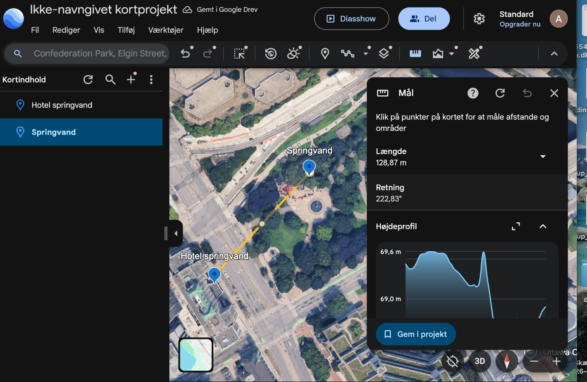
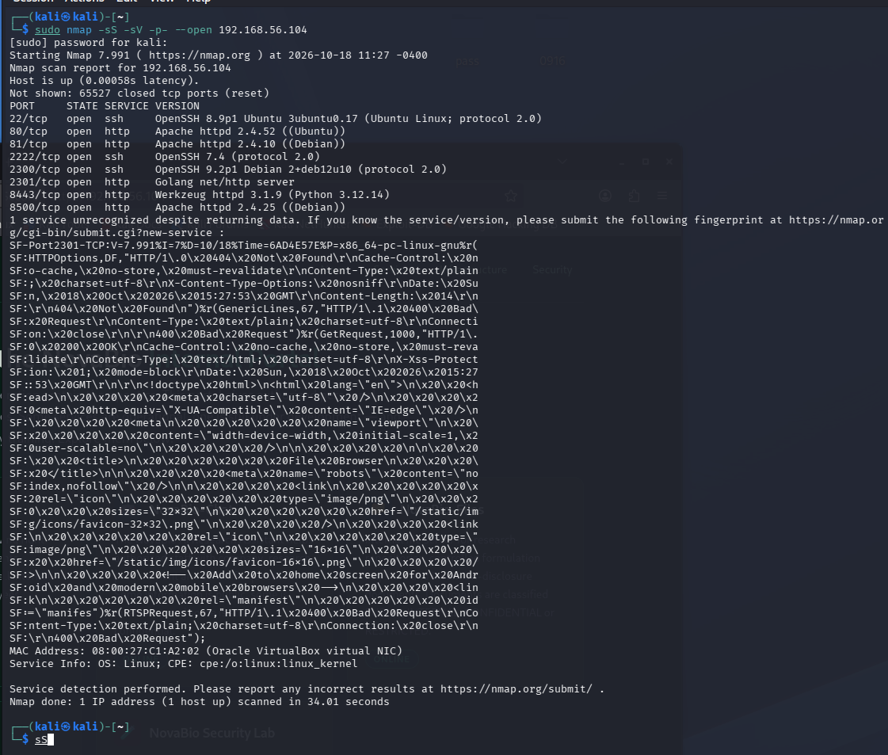
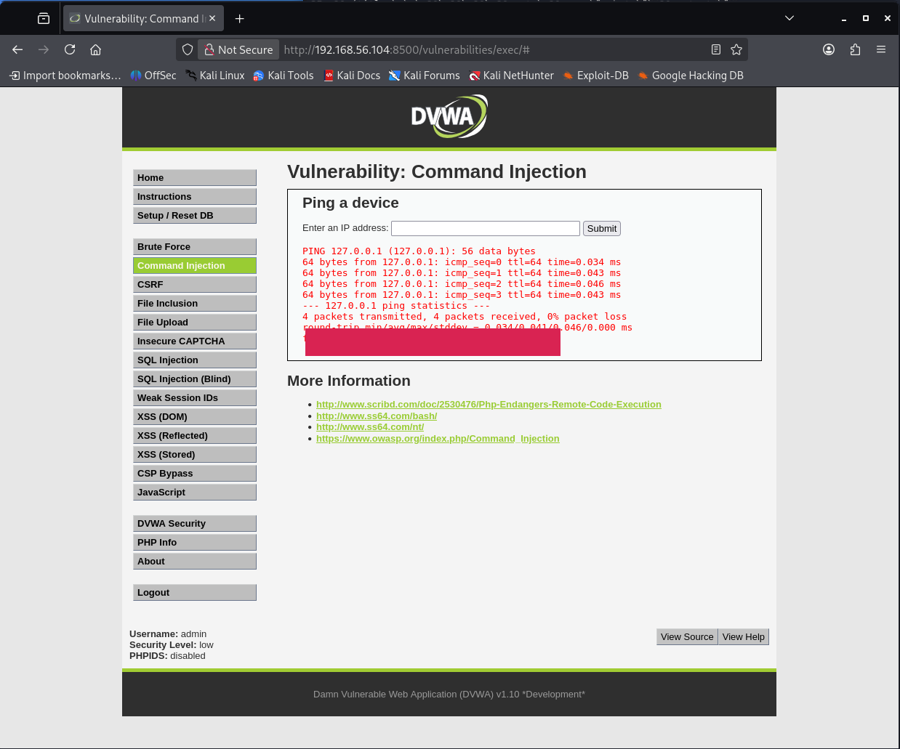
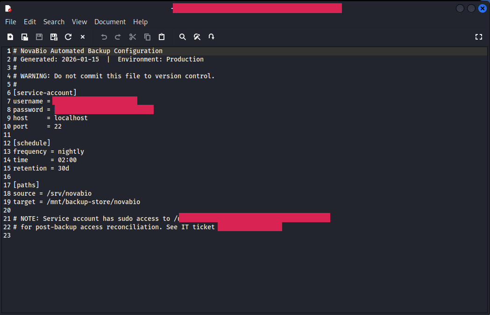
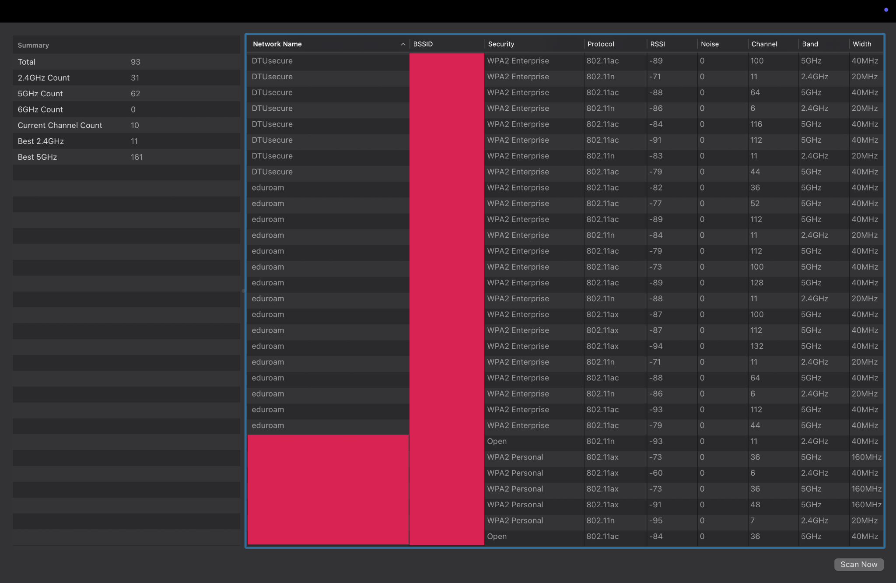
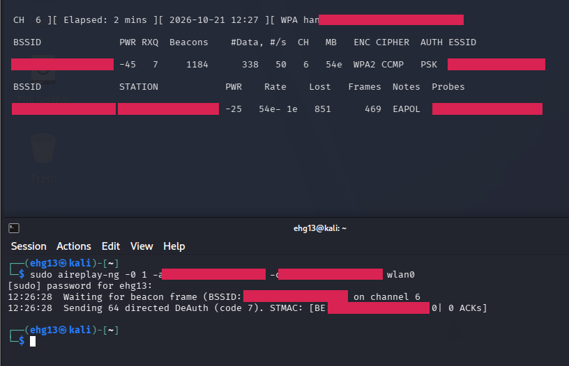

# Ethical Hacking — Security Assessment Labs

Technical University of Denmark (DTU) | 02275 Ethical Hacking | Autumn 2026

Cybersecurity · Network Security · Vulnerability Assessment · Security Research

## Project Overview

A hands-on cybersecurity project focused on identifying, analysing and understanding security vulnerabilities across networks, web applications, authentication systems and wireless infrastructure.

The project combined practical security assessments in authorised laboratory environments with technical investigation, vulnerability analysis and structured documentation.

The work covered five weeks of cybersecurity exercises, providing experience with both offensive security techniques and defensive security principles.

## Technologies & Technical Skills

| Category | Tools & Methods |
|---|---|
| Operating Systems | Kali Linux, Linux |
| Network Analysis | Wireshark, TCP/IP, packet inspection |
| Reconnaissance | Nmap, DIRB, OSINT, service enumeration |
| Web Security | HTTP analysis, authentication testing, exposed resource identification |
| Password Security | Hash identification, password auditing, brute-force concepts |
| Wireless Security | Wi-Fi reconnaissance, WPA2-PSK assessment, router security |
| Virtualisation | VirtualBox, isolated laboratory networks |
| Investigation | Google Earth, public-source research, evidence validation |
| Documentation | Technical reporting, vulnerability analysis, mitigation recommendations |

## Security Investigations

### 01 — OSINT & Passive Reconnaissance

Investigated how publicly available information can reveal organisational and technical details.

- Image-based location identification and geographical investigation.
- Public-source research and organisational reconnaissance.
- Evidence verification and evaluation of information exposure.

### 02 — Network & Web Security

Analysed network traffic and investigated vulnerabilities in controlled laboratory environments.

- Packet inspection and TCP SYN scan identification.
- Network reconnaissance and service discovery.
- Exposed web resources and insecure authentication mechanisms.
- Identification of security misconfigurations.

### 03 — Password & Authentication Security

Explored authentication weaknesses and common password security risks.

- Password hash identification and auditing.
- Dictionary and brute-force attack concepts.
- Insecure credential transmission.
- Authentication weaknesses and defensive measures.

### 04 — System Security & Vulnerability Assessment

Investigated security weaknesses in course-provided systems.

- Identification of exposed services and insecure configurations.
- Investigation of application vulnerabilities and access-control weaknesses.
- Evaluation of security implications and potential attack paths.
- Documentation of recommended mitigations.

### 05 — Wireless Network Security

Performed wireless security investigations using authorised DTU laboratory equipment.

- Wi-Fi access point discovery and security assessment.
- WPA2-PSK authentication analysis.
- Router administration and authentication testing.
- Identification and documentation of wireless security weaknesses.

---

## Project Screenshots

### OSINT & Geographic Analysis

### System Reconnaissance

### Web Command Injection

### System Exploitation Lab

### Wi-Fi Network Discovery

### WPA2 Handshake Analysis

### Router Security Assessment

## My Role & Contributions

Security Investigation · Technical Analysis · Vulnerability Assessment · Technical Documentation

I made substantial contributions to the practical investigations and technical documentation of the project, particularly within OSINT, system security and wireless network security.

My documented work covered Weeks 2, 5 and 6, combining hands-on investigation, analysis of technical evidence and preparation of structured security documentation.

### OSINT & Security Research

- Investigated publicly accessible information through geographical analysis, image-based evidence and organisational research.
- Cross-checked findings against multiple sources and evaluated their reliability.
- Documented investigation methods, observations and security implications.

### System Security Assessment

- Contributed to vulnerability investigations involving controlled laboratory systems and applications.
- Examined insecure configurations, exposed resources and potential security weaknesses.
- Analysed findings and contributed to explaining their impact and appropriate mitigations.

### Wireless Security Investigation

- Contributed to Wi-Fi reconnaissance and assessment of wireless network configurations.
- Worked with authentication security assessments and router administration testing.
- Investigated weaknesses in access controls and administrative authentication.
- Documented technical observations, results and security recommendations.

### Technical Documentation & Reporting

Alongside the practical investigations, I took responsibility for developing and structuring technical report material for my assigned work.

My contributions included:

- Preparing clear explanations of investigation objectives and methodologies.
- Organising technical observations, supporting evidence and test results.
- Analysing the security significance of identified weaknesses.
- Documenting practical mitigation recommendations.
- Translating complex technical findings into structured, understandable reporting.

This work strengthened my ability to combine practical cybersecurity investigation with analytical problem-solving and professional technical communication.

## Key Findings & Lessons Learned

| Security Area | Key Learning |
|---|---|
| Information Exposure | Publicly available information can reveal sensitive organisational details |
| Network Security | Packet analysis can expose insecure communication and network activity |
| Authentication | Weak credentials and insufficient access controls increase security risk |
| Web Security | Misconfigurations and exposed resources can disclose sensitive information |
| Wireless Security | Strong authentication and secure router configurations are essential |
| Security Reporting | Findings must be supported by evidence and realistic mitigation recommendations |

## Engineering Skills Developed

Through this project, I gained experience in:

- Systematic investigation and technical problem-solving.
- Working with cybersecurity tools and unfamiliar systems.
- Interpreting network traffic, application behaviour and security evidence.
- Evaluating vulnerabilities and identifying defensive measures.
- Preparing professional technical documentation.
- Collaborating on practical cybersecurity assessments.

## Security & Ethics

All active security testing was conducted within authorised DTU educational environments using course-provided systems, controlled laboratory networks and approved equipment.

Sensitive laboratory credentials and detailed exploitation material are intentionally excluded from this portfolio.

---

Malik Yildirim  
Software Engineering Student | Technical University of Denmark

Course: 02275 Ethical Hacking  
Period: Autumn 2026  
Report Coverage: Weeks 2–6  
My Documented Contributions: Weeks 2, 5 and 6

*Detailed technical evidence and the original group report are retained separately.*
